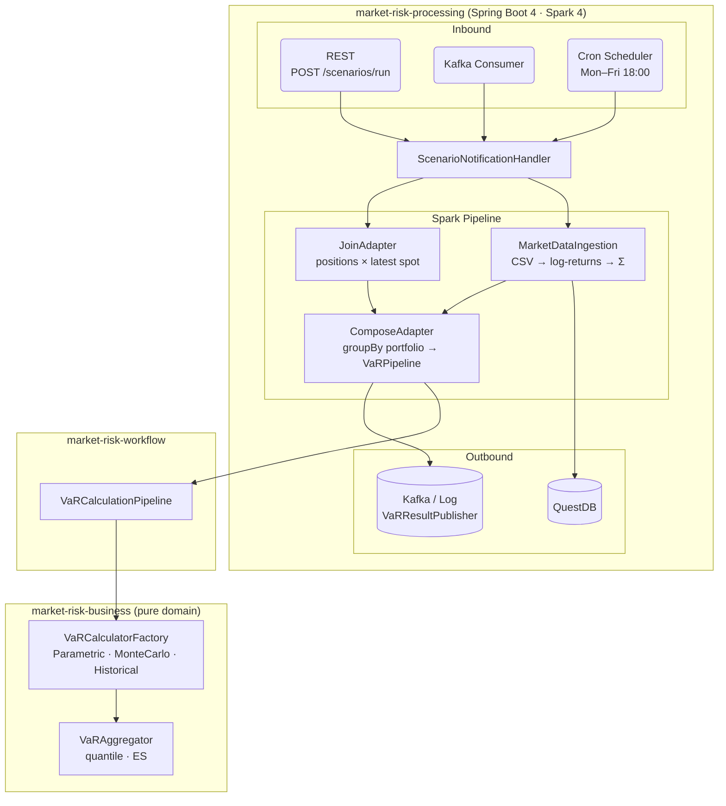

# Market Risk Quant Platform

[](https://github.com/kacemjd/market-risk-quant/actions/workflows/ci.yml)
[](https://codecov.io/gh/kacemjd/market-risk-quant)

Java-first VaR/ES platform — Parametric, Monte Carlo (Cholesky GBM), and Historical Simulation — built on **strict Hexagonal Architecture** with Spring Boot 4 and Apache Spark 4.

The project target is the **VaR/ES Engine — Risk Dashboard Design Document**, design v1 dated 15 September 2026 (`var-risk-dashboard-design.pdf`). The initial implementation stays in Java. The document's Python/PySpark and Streamlit choices are reference proposals, not a decision to migrate this repository. A Python implementation may be considered later.

**Current state:** this repository provides the Java risk engine, scenario orchestration, persistence adapters, and result APIs. The three-screen dashboard described below is the target, not an implemented feature. Mockup values, GPU acceleration, neural-surrogate results, and regulatory metrics must not be presented as existing capabilities.

The platform is engineered around two non-negotiable principles:

| Principle | How it is applied |
|---|---|
| **Hexagonal Architecture** | Domain (`market-risk-business`) is 100 % framework-free. All I/O crosses a named port. Adapters are the only code allowed to touch Spring, Spark, Kafka, or QuestDB. Dependency direction is enforced by the Maven module graph: `processing → workflow → business`. |
| **Behavior-Driven Development (BDD)** | All quantitative scenarios are specified as Cucumber feature files before implementation. Feature files act as the living specification of the VaR engine and are executed on every CI run. |

---

## Product Target

The dashboard should demonstrate **risk judgement, not just numbers**, for GitHub visitors, take-home reviewers, and quant/risk interviewers.

| Screen | Unit of analysis | Target capabilities |
|---|---|---|
| **1. Risk desk** | Portfolio / desk | VaR/ES, P&L distribution, component VaR, diversification, backtesting, exceptions, and a traffic-light verdict |
| **2. Extended metrics** | Risk factor / model | Sensitivities, model comparison and convergence, surrogate tail error, FRTB P&L attribution diagnostics, modellability, and limit utilisation |
| **3. Counterparty risk** | Netting set / counterparty | EE/EPE/PFE, IMM and SA-CCR EAD comparison, CVA, capital metrics, collateral effects, and wrong-way-risk flags |

The first delivery is **Screen 1**. Screens 2 and 3 depend on additional quantitative models and data; they are not placeholder panels populated with invented results.

See the [revised Java dashboard design and delivery plan](docs/java-risk-dashboard-design.md) for screen layouts, current architecture gaps, the agreed local/Spark execution direction, implementation dependencies, acceptance criteria, and open decisions.

### Product principles

- **Verdict first:** lead with a traffic-light zone, diagnostic status, or limit gauge, with its observation window and thresholds visible.
- **Expose weaknesses:** show approximation labels, unavailable data, limit warnings, and model tail errors rather than hiding them.
- **Reconcile the numbers:** component VaR must sum to total VaR; show diversification explicitly and distinguish additive components from standalone risks.
- **One engine, two risk types:** ultimately reuse the same identified Monte Carlo paths for portfolio P&L and trade-level mark-to-market exposure, with different aggregation rules.
- **Reproducible evidence:** every displayed result must identify its run, data snapshot, method, confidence level, and horizon. Clearly label synthetic/demo data.

### Risk desk acceptance criteria

| Area | Required behaviour |
|---|---|
| Run context | Show portfolio/desk, close-of-business (COB) date, run ID, method, path count, currency, and backtesting zone |
| Headline metrics | VaR 99% at 1 day, ES 97.5% at 1 day, approximate 10-day VaR, and exceptions over 250 business days; show comparable prior-run changes when available |
| Confidence levels | Compute VaR at 99% and ES at 97.5% independently from the same distribution; the current result model has one shared `alpha` and cannot represent this pair as-is |
| Horizon | Define and verify the 1-day P&L horizon before applying square-root-of-10 scaling; label the 10-day value as an approximation, not a separately simulated result |
| Distribution | Histogram with method selector (Monte Carlo / Historical / Parametric), red VaR line and tail shading, amber ES line; disclose when a method has no empirical scenarios |
| Attribution | Component VaR by desk reconciles to total VaR within a documented numerical tolerance; diversification is total VaR minus the sum of standalone VaRs |
| Backtesting | Show the last 60 business days of P&L versus previously forecast VaR, mark exceptions where P&L is strictly below negative VaR, and calculate the 250-day exception count and Kupiec unconditional-coverage p-value |
| Traffic light | For a complete 250-day, 99% VaR backtest: green at 0–4 exceptions, amber at 5–9, red at 10 or more; insufficient history is explicitly unavailable, not green |
| Presentation | Verdict and four metric cards first; desktop side-by-side panels, mobile single-column panels with a 2-by-2 card grid; navigation to model comparison when available and to source code |

The PDF's visual semantics remain the target: purple primary data, red breaches/VaR, amber warnings/ES, green benefits/pass, and grey neutral/gross values. Limits use green below 70%, amber from 70% through 90%, and red above 90%; backtesting zones use exception counts instead. Regulatory-style diagnostics require documented conventions and validated inputs, not a claim of regulatory approval.

---

## Quick Start (Docker)

**Prerequisites:** Docker & Docker Compose

```bash
docker compose up
```

The REST API is available at `http://localhost:8080`.

### Run a scenario

```bash
curl -X POST http://localhost:8080/scenarios/run \
  -H "Content-Type: application/json" \
  -d '{
    "portfolioCsvPath": "/data/portfolio.csv",
    "pricesCsvPath":    "/data/prices",
    "asOfDate":         "2024-12-31",
    "confidenceLevel":  0.99,
    "numPaths":         10000,
    "timeGrid":         "GRID_53"
  }'
# → HTTP 202  { "correlationId": "..." }
```

---

## Local Dev (no Docker)

**Prerequisites:** JDK 21+, Maven 3.9+

```bash
# build + tests
mvn clean verify

# run locally (Spark in-process, REST on :8080)
mvn spring-boot:run -pl market-risk-processing -Plocal
```

---

## Stack

| Layer | Technology |
|---|---|
| Language | Java 21 |
| Framework | Spring Boot 4.0.5 |
| Compute | Apache Spark 4.0.0 (Scala 2.13) |
| Persistence | QuestDB |
| Messaging | Apache Kafka (optional) |
| Build | Maven multi-module |

---

## Architecture

Three-module Maven project. Dependency direction is strictly inward: `processing → workflow → business`.

```
market-risk-quant/
├── market-risk-business/     pure domain — Java 21, zero framework
├── market-risk-workflow/     orchestration contracts — no Spring, no Spark
└── market-risk-processing/   Spring Boot 4 + Spark 4 application
```

Inbound triggers: REST, Kafka consumer, cron scheduler.  
Outbound: QuestDB (persistence) + Kafka / logging (VaR result publishing).

### Java-first dashboard evolution

Keep quantitative calculations and diagnostic rules in the framework-free business module, orchestration and run contracts in workflow, and storage/API integration in processing adapters. The selected frontend is **React + TypeScript + Vite**, consuming Java REST APIs. Java-first refers to the engine and backend, not a requirement to replace browser technologies with Java; the dashboard is not implemented yet.

The existing `GET /results` and `GET /results/history/{portfolioId}` APIs expose aggregate results. They do not yet supply the scenario distribution, desk attribution, realised/hypothetical P&L history, or complete run provenance required by Screen 1. Extend the ports and result contracts before wiring charts; do not derive missing distributions or backtests from aggregate VaR values.

Persist the design's run metadata: `run_id`, `cob_date`, `git_sha`, `config_hash`, `n_paths`, `seed`, `device` (initially CPU), `runtime_s`, and `data_snapshot_id`. Also record portfolio/desk, method, confidence levels, horizon/time grid, and currency. Define how the existing correlation ID relates to the run ID and how multiple methods belong to a comparable run. QuestDB remains the existing aggregate-result store; Parquet/Delta path or scenario storage is a future adapter choice, not an existing dependency.

**Shared-path target:** market risk aggregates trade P&L to portfolio/desk loss distributions; counterparty risk aggregates trade mark-to-market values at each time step under netting and collateral rules before computing positive exposure. Reusing simulation paths avoids independent, inconsistent scenario sets, but exposure analytics still require time-stepped trade pricing, a netting-set/CSA model, and credit inputs. The current aggregate `VaRResult` is not a reusable path store.



---

## Data Formats

**Portfolio CSV** — `portfolioId,ticker,quantity,assetClass`

**Prices CSV** — `Ticker,Date,Open,High,Low,Close,Volume,OpenInt`  
(`Date` must be `YYYY-MM-DD`; only `Ticker`, `Date`, `Close` are consumed.)

---

## Testing

```bash
mvn test -pl market-risk-business                         # unit tests
mvn test -pl market-risk-business -Dtest=CucumberRunner   # BDD
mvn verify -pl market-risk-processing                     # integration
```

---

## Roadmap

The dashboard design is the product roadmap. Delivery order follows quantitative/data prerequisites, rather than the PDF's Python-specific tooling or effort estimates.

| Phase | Scope | Prerequisites / completion gate |
|---|---|---|
| Existing foundation | Java engine, hexagonal modules, REST/Kafka/scheduler triggers, QuestDB adapters, aggregate result queries, unit/BDD/integration coverage | Preserve existing behaviour while extending contracts |
| **v1a — Risk desk data** | Reproducible run metadata, explicit confidence/horizon conventions, scenario distribution access, component/standalone VaR, P&L backtesting, Kupiec test | BDD scenarios for confidence levels, exception boundaries, insufficient history, reconciliation, and horizon scaling |
| **v1b — Risk desk dashboard** | React/TypeScript/Vite Screen 1, method selector, run context, cards, histogram, attribution, backtest, responsive design, explicit unavailable states | Confirm charts and serving integration; satisfy the Risk desk acceptance criteria with traceable engine results |
| **v2 — Extended metrics** | Model comparison/convergence and FRTB PLA diagnostics, then DV01/vega/CS01/gamma, modellability counts, and limit gauges | Implement required sensitivities and HPL/RTPL datasets; GPU/neural-surrogate panels only after actual models and measured benchmarks exist |
| **v3 — Counterparty risk** | Screen 3: collateralised/uncollateralised profiles, EE/EPE/effective EPE/PFE, SA-CCR waterfall and IMM comparison, CVA, counterparty table, WWR flags, and PFE limits | Reusable time-stepped paths, trade/netting-set/CSA models, credit curves, validated exposure and capital conventions |
| Supporting engineering | Metrics and structured logging, correlation/run-ID propagation, distributed tracing, run registry and run comparison, data-quality gates | Support dashboard provenance and diagnosis; do not confuse a Grafana operational dashboard with the product's risk screens |
| Stretch quant | Stress windows and hypothetical shocks, marginal/incremental VaR, concentration, correlation/eigenvalue drift, distribution diagnostics, liquidity-horizon ES, capital comparisons, collateral/MPoR analysis, rating migration, and DVA | Add incrementally with documented assumptions and quantitative validation |

### Decisions deferred

- **Frontend integration:** React/TypeScript/Vite is selected; confirm the chart library and static-asset serving/build arrangement. A possible Python backend migration would not require replacing this frontend if API contracts remain compatible.
- **Counterparty data:** decide synthetic versus public CDS curves, exposure horizon/time steps (the mockup suggests quarterly steps to five years), and collateral assumptions.
- **Capital scope:** decide BA-CVA versus SA-CVA once the required inputs and sensitivities are available.
- **Acceleration:** benchmark the Java CPU baseline before choosing GPU integration or a neural surrogate; retain full-pricer comparisons and tail-error diagnostics.
- **Possible Python migration:** reassess after a working Java Risk desk. If approved, preserve versioned run/result contracts, reference datasets, and BDD expectations, and establish cross-language numerical parity before replacing the Java engine. No migration is committed at this stage.
