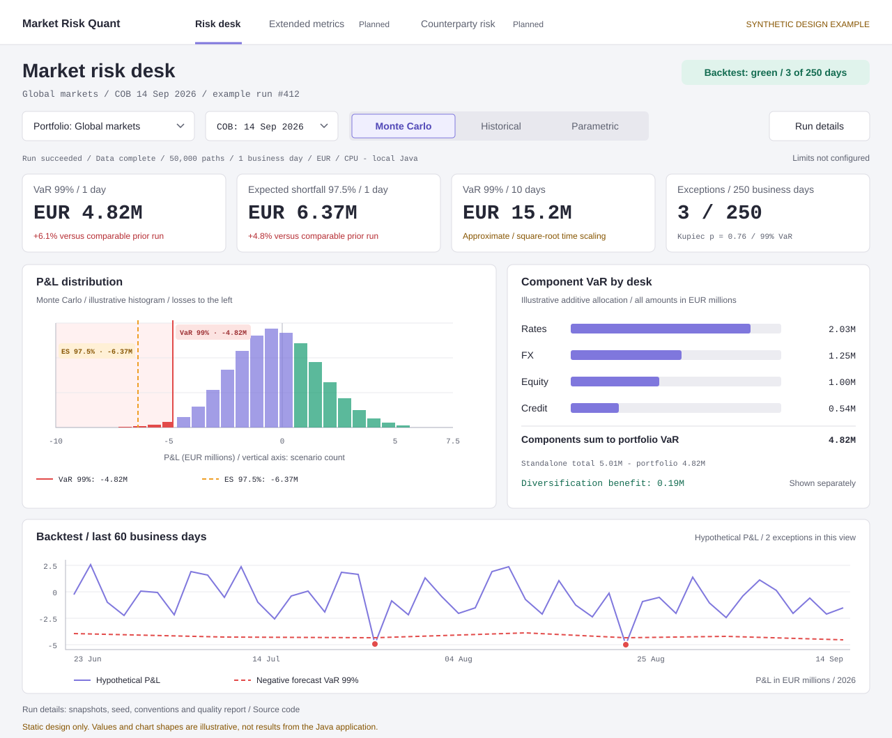
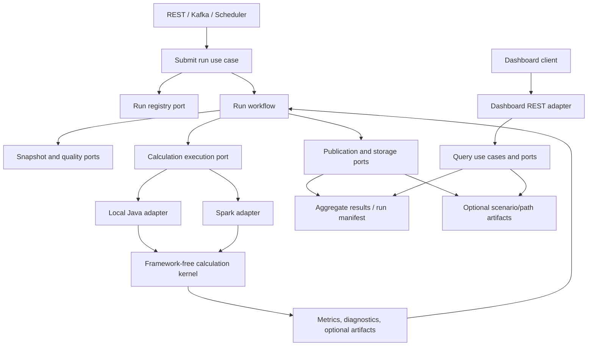

# Java Risk Dashboard: Revised Design and Delivery Plan

| Document context | Value |
|---|---|
| Date | 30 September 2026 |
| Status | Design proposal and implementation plan; not implemented |
| Starting point | The existing `market-risk-quant` Java application |
| Reference | `var-risk-dashboard-design.pdf`, design v1, 15 September 2026 |

## 1. Purpose and decisions

Build a reviewer-facing dashboard that explains risk, model limitations, and the evidence behind a result. The audience is GitHub visitors, take-home reviewers, and quant/risk interviewers. The primary task is to select a completed run, understand its risk position, and inspect the supporting calculations.

This document adapts the PDF to the Java repository rather than assuming a new Python/PySpark application.

| Decision | Standing |
|---|---|
| Java engine and backend first | Agreed |
| React + TypeScript + Vite frontend, consuming Java REST APIs | Agreed on 30 September 2026; not yet implemented |
| Local Java and Spark execution behind one interchangeable boundary | Agreed direction; not yet implemented |
| Risk desk first, Extended metrics second, Counterparty risk third | Established delivery order |
| Keep the existing three-module structure; avoid microservices initially | Recommendation |
| Asynchronous run submission, durable run status, and separate dashboard reads | Recommendation to review |
| Chart library, frontend serving arrangement, artifact storage, and registry persistence | Open |
| GPU, neural surrogate, and Python migration | Deferred; not prerequisites for v1 |

The scope of this document is design and planning only. Implementation should preserve existing behaviour through explicit compatibility decisions, not silently relabel current calculations as the new dashboard metrics.

## 2. Existing application and gaps

| Area | What exists | What must change or be added |
|---|---|---|
| Modules | Framework-free business calculations, workflow contracts, Spring/Spark processing adapters | One authoritative workflow; clear execution and query ports |
| Calculation | Parametric, Monte Carlo, Historical VaR, and ES | Separate confidence levels, consistent horizons, scenario evidence, attribution |
| Pricing | Linear and delta-gamma P&L pricers | Ingestion currently creates linear spot-style positions; richer instruments are a later extension |
| Data ingestion | CSV and Alpha Vantage price adapters, portfolio CSV loading | Dated snapshots, business-date alignment, coverage checks, provenance |
| Calibration | Annualised volatility, correlation, covariance | Explicit units, minimum observations, finite-value and matrix validation |
| Execution | Spark distributes portfolio groups | Local adapter; common calculation kernel; stable work/scenario identities |
| Orchestration | `ScenarioNotificationHandler` calls `JoinAdapter` and `ComposeAdapter` | Move run coordination behind framework-free use cases; reconcile the unused `VaRCalculationPipeline` |
| Triggers | REST, Kafka, scheduler | Run submission/status model; REST currently blocks through calculation despite returning HTTP 202 |
| Storage | QuestDB aggregate results and calibration records | Run registry, richer aggregate contracts, optional scenario artifacts |
| Queries | `GET /results` and `GET /results/history/{portfolioId}` | Dashboard read models behind query ports; controllers currently execute SQL |
| UI | No dashboard implementation | Revised screens, accessible charts, filtering, explicit availability states |
| Validation | Unit, Cucumber, and integration test sources | New quantitative fixtures, lifecycle tests, execution parity, UI state coverage |

### Quantitative blockers for the first screen

1. **Confidence:** `VaRResult` has one `alpha`; it cannot describe VaR at 99% and ES at 97.5% independently.
2. **Horizon:** `MaturityGrid.GRID_53` accumulates 53 weekly increments. Parametric uses annualised covariance without a requested-horizon conversion; Historical uses daily return scenarios. These outputs must not be compared as 1-day estimates today.
3. **Dates:** `JoinAdapter` sorts prices and converts them to undated arrays. Calibration cannot verify that corresponding observations occurred on the same business date.
4. **History:** the requested historical window is used as calendar days during loading. Historical calculation can repeat early observations when history is short. Define actual observation counts instead of manufacturing a full window.
5. **Evidence:** Monte Carlo and Historical calculations discard their P&L vectors after aggregation. `MarketShockGenerator` returns accumulated factor shocks, not intermediate time states.
6. **Coverage:** loaders/calibration can drop data, and missing prices can become zero spot values. Missing input must be visible in run quality and must not produce an apparently complete risk verdict.

## 3. Revised dashboard structure

Keep the PDF's three analytical screens, but add a shared run context and separate three meanings of "OK": successful execution, sufficient data, and acceptable risk.

### Shared shell

```text
Market Risk Quant
Risk desk | Extended metrics | Counterparty risk

Portfolio / desk     COB date     Completed run     Method
Reporting currency   Horizon      Execution backend

Run: Succeeded       Data: Complete       Backtest: Green (3 / 250)
Limits: Not configured

[Screen-specific analysis]

Run details | Assumptions and conventions | Source code
```

This is a structural wireframe, not an implemented screen. Status values above are illustrative.

| Shared element | Behaviour |
|---|---|
| Run selection | Show completed runs by default; a separate run panel exposes queued, running, and failed submissions |
| Context | Portfolio/desk, COB date, method, horizon, reporting currency, snapshot IDs, actual observation/path counts |
| Run details | Run/correlation IDs, git revision, configuration hash, seed, engine version, backend/device, timing, quality diagnostics, artifact references |
| Status strip | Separate execution, data quality, backtesting zone, and limit status; no single global green badge |
| Comparison | Prior-run changes only for a comparable portfolio, currency, method, horizon, confidence, and P&L convention; otherwise explain why comparison is unavailable |
| Navigation | Future screens are labelled planned until implemented; no apparently working tabs backed by invented numbers |

Filtering reads persisted results. Selecting a method must not silently launch a calculation. A user explicitly submits a new run when the selected combination has no result.

### Availability and failure states

| State | Display and action |
|---|---|
| No runs | Explain the required inputs and provide an explicit create-run action |
| Queued/running | Show current stage and run ID; no fabricated percentage progress |
| Failed | Show the failed stage and safe diagnostic summary; link to details |
| Loading | Preserve labels and layout; never briefly display zero as a risk value |
| Missing artifact | Display unavailable with reason; retain available summaries without implying a complete screen |
| Insufficient backtest | Show available observation count; withhold the 250-day zone |
| Storage/API unavailable | Explicit error and retry action, distinct from an empty dataset |
| Historical run | Display its COB/data dates clearly; do not mistake an intentionally old run for a failed calculation |
| Demo data | Persistent synthetic/demo label and dataset provenance |

## 4. Screen 1: Risk desk

**Question:** What is the portfolio's risk, and what evidence supports the verdict?



The image is the primary design direction. It intentionally preserves the original analytical
dashboard structure; refinement is limited to typography, spacing, selection clarity, and chart
craft rather than introducing a new visual concept. Values and chart shapes are illustrative; they
do not imply that the Java backend already supplies these panels.

### Changes to the original screen

Preserve the four-card row, histogram/attribution pair, full-width backtest, light surfaces, and
purple/red/amber/green visual language.

| Original screen | Revision | Reason |
|---|---|---|
| Unqualified "Green zone" | "Backtest: green / 3 of 250 days" | The badge describes backtesting, not data completeness or all risk limits |
| Method selector inside histogram | Page-level Monte Carlo / Historical / Parametric selector | Headline metrics, distribution, attribution, and the method-specific backtest must refer to the same selected result scope |
| Desk bars 2.12M + 1.30M + 1.01M + 0.58M, then -0.19M diversification | Additive components sum to 4.82M; show standalone sum 5.01M and diversification separately | Original desk bars sum to 5.01M, so they do not represent components of 4.82M as labelled |
| Small square-root scaling note | Explicit approximation text on the 10-day card | Visually distinguish a scaled estimate from independently simulated horizon risk |
| Exceptions card says only "3" | "3 / 250", confidence and Kupiec diagnostic | Show the denominator and applicability of the verdict |
| Backtest has little date/unit context | Date axis, currency units, P&L convention, forecast legend, and visible-window exception count | Distinguish the 60-day plot from the 250-day diagnostic |
| Run context mixed with chart settings | Compact page context and a separate Run details affordance | Keep essential evidence visible without turning the header into a configuration form |

In the revised illustrative allocation, `2.03 + 1.25 + 1.00 + 0.54 = 4.82M`. The signed diversification adjustment remains `4.82 - 5.01 = -0.19M`; the mockup displays its equivalent positive benefit, `0.19M`, with that label. These are design examples, not an attribution algorithm.

### Interaction contract

Changing portfolio, COB/run, or method selects a compatible persisted result; it does not mutate only one chart. Fetches must retain the selection identity, discard stale responses, and avoid presenting a mix of two runs during loading.

If a method has no completed result, show "No completed run for this method" with an explicit create-run action. Do not substitute a different method or trigger calculation automatically. Backtesting is tied to a versioned forecast series, not assembled from arbitrary repeated runs.

Histogram details expose bin boundaries and scenario counts. Component details expose the allocation method, signed amount, and standalone comparison. Backtest details expose date, forecast, P&L and breach status. Each chart also has a keyboard-accessible table alternative.

The desktop layout below is the default; mobile preserves the order with two-by-two metric cards, one chart per row, and filter controls that wrap rather than overflow.

```text
Risk desk: [portfolio/desk]       [COB] [run] [method] [currency]
[Execution status] [Data quality] [Backtest zone] [Limit status]

VaR 99% / 1d     ES 97.5% / 1d     VaR 99% / 10d     Exceptions / 250d
amount + change  amount + change   approximate       count + Kupiec p

P&L distribution                  Component VaR by desk
empirical histogram /             additive contributions,
labelled analytical density       standalone comparison and diversification

Backtest: last 60 business days
P&L and previously forecast VaR; exceptions marked on the series

Conventions and data quality summary
```

### Metrics and chart conventions

| Element | Revised requirement |
|---|---|
| VaR and ES | Backend returns each amount with its own confidence level and the common horizon/currency |
| 10-day VaR | Backend computes square-root-of-10 scaling from a verified 1-day result; label "Approximate: square-root time scaling" and disclose assumptions |
| P&L axis | Negative values are losses. Plot risk amounts at their corresponding negative P&L locations |
| Distribution | MC/Historical use actual observations. Parametric may show an explicitly labelled analytical density, not a fabricated empirical histogram |
| Tail markers | Red VaR 99% line/tail shading; amber ES 97.5% line. ES at a different confidence level is not required to lie beyond VaR 99% |
| Attribution | State the allocation method and grouping. Contributions reconcile to total VaR within a versioned tolerance; never sum desk VaRs and call that portfolio VaR |
| Diversification | Total VaR minus the sum of standalone VaRs. Show separately from additive component contributions to avoid counting it twice |
| Backtest | Pair each forecast with the subsequent matching P&L period, using data available at forecast time; no look-ahead |
| Exceptions | P&L strictly below negative forecast VaR; equality is not an exception |
| Traffic light | For a complete 250-business-day, 99% backtest: green 0-4, amber 5-9, red 10 or more |
| Kupiec diagnostic | Report observation count, confidence, test statistic/p-value and convention; define zero/all-exception edge cases |
| Limits | Only show utilisation when a limit with matching scope, unit, and horizon exists |

For additive attribution, begin with a documented analytical method for Parametric. MC/Historical require their own justified estimators and uncertainty treatment; unavailable method-specific attribution is preferable to a misleading allocation.

The backtest dataset must declare realised versus hypothetical P&L and treatment of position changes, fees, cashflows, and currency conversion. Price history alone is not a complete backtest.

## 5. Screen 2: Extended metrics

**Question:** Which drivers, assumptions, and model weaknesses explain the result?

| Panel | Revised Java-first scope | Dependency |
|---|---|---|
| Sensitivities | DV01 by tenor/currency, vega, CS01, gamma; explicit units and signed values | Curve/surface models, instrument definitions, validated bump-and-reprice or analytical sensitivities |
| Model comparison | Begin with comparable Java calculations and measured CPU runtimes; label models and pricing approximations accurately | Fixed benchmark inputs, runtime boundaries, reference results |
| Convergence | VaR versus scenario count with a documented uncertainty estimator | Repeatable scenario prefixes or repeated independent runs; uncertainty is not merely P&L standard deviation |
| Surrogate comparison | Full-pricer versus surrogate accuracy, pricing RMSE, tail error, runtime and speedup | Actual surrogate and actual full-pricer reference; current linear/delta-gamma calculations are not automatically a full pricer |
| PLA diagnostics | HPL/RTPL series, Spearman correlation and KS statistic; show thresholds and policy version | Aligned independently defined P&L datasets; confirmed regulatory reference and boundary rules |
| Modellability | Count/percentage with observation evidence | Risk-factor mapping and RFET observation rules; no proxy percentage inferred from price availability |
| Limits/stress | VaR, stressed VaR, sensitivities, usage and breach indicators | Versioned limit definitions and stress calculations |

Retain the PDF's comparison-first emphasis, but do not display GPU or neural-surrogate cards before those capabilities exist. FRTB-style panels are educational diagnostics unless their full data, methodology, and applicability have been validated; a green chart is not a regulatory approval claim.

## 6. Screen 3: Counterparty risk

**Question:** Where are exposures concentrated, and what do netting, collateral, and credit assumptions change?

| Panel | Target contents | Prerequisites |
|---|---|---|
| Context | Counterparty, COB, netting-set count, exposure horizon/grid, collateral convention | Trade/counterparty/netting-set/CSA models |
| Headline metrics | SA-CCR EAD, IMM-style comparison, total CVA, peak PFE with time; capital only when available | Validated calculation scope and required parameters |
| Exposure profile | EE and PFE through time, EPE/effective EPE summaries, collateralised/uncollateralised comparison | Time-stepped trade valuations and collateral mechanics |
| SA-CCR explanation | RC, multiplier, add-ons, alpha and resulting EAD, with supporting netting/collateral inputs | Applicable asset-class formulas, maturity factors, margin rules, and parameter version |
| Counterparty table | EAD, CVA, rating, WWR diagnostics and availability | Credit inputs and a defined WWR model/diagnostic |
| Limits | PFE utilisation at the relevant counterparty/horizon | Matching exposure-limit definitions |

Use discounting, marginal default probabilities, and LGD explicitly in the CVA convention. An IMM-style proxy based on effective EPE must be labelled as a proxy unless applicable maturity and regulatory requirements are implemented. Do not infer WWR from a counterparty's name or rating.

Shared simulation infrastructure is the target, not a promise that identical paths are valid for every measure. Record simulation measure, dynamics, calibration, factor universe and grid; reuse an identified path set only when those assumptions are compatible.

A hump-shaped exposure curve may suit the PDF's example book, but it is not a universal acceptance criterion. Test shapes against the chosen instruments and cashflows.

## 7. Visual and interaction specification

The PDF is the visual reference; no replacement branding is required.

| Topic | Specification |
|---|---|
| Hierarchy | Run context and qualified verdict first, headline metrics second, explanatory charts third, assumptions/details last |
| Colour | Purple `#7F77DD` primary data, red `#E24B4A` breaches/VaR, amber `#EF9F27` warnings/ES, green `#1D9E75` benefits, grey `#B4B2A9` neutral |
| Meaning | Colour is supplementary to text, markers and line styles; sign and benefit are not interchangeable |
| Limits | Green below 70%, amber 70%-90% inclusive, red above 90%; distinguish this warning scheme from a contractual breach above the actual limit |
| Numeric labels | Currency/unit, confidence and horizon visible; consistent precision; exact values available in details |
| Responsive layout | Desktop: four metrics and two chart columns. Mobile: two-by-two metrics, single-column panels, legends below charts |
| Accessibility | Keyboard-accessible filters, visible focus, labelled controls, readable contrast, text/table alternatives for charts, no hover-only essential information |
| Feedback | Explicit loading/error/unavailable states; announce status changes without repeatedly interrupting chart navigation |
| Precision | Rounded display values never determine zone, utilisation, exception, or pass/fail classifications |

### Frontend technology

**Selected:** React + TypeScript + Vite, consuming Java REST APIs. This is a separate browser presentation layer, not a migration of the quantitative engine.

| Layer | Direction | Standing |
|---|---|---|
| UI | React components for shared context, metric cards, chart panels, details and unavailable states | Selected |
| Language | TypeScript with typed, versioned API contracts | Selected |
| Build | Vite for development and a static production bundle | Selected |
| Charts | Apache ECharts with modular imports; React owns the chart lifecycle through a small adapter | Recommendation |
| Alternative charts | Plotly if scientific exploration, specialised plots or notebook-style interaction becomes central | Alternative to evaluate, not a second chart stack |
| Server state | TanStack Query for caching by result identity, retries where safe, request cancellation and conditional status polling | Recommendation |
| Styling | Shared CSS tokens and reusable primitives following the PDF; a styling framework is optional | Recommendation |
| Backend | Spring Boot REST APIs; Spark/local execution remains behind backend ports | Existing backend plus planned API contracts |

ECharts is recommended for the histogram, signed component bars, time-series backtest, heatmaps and later exposure profiles. Confirm chart accessibility and bundle size with the selected imports; a chart library does not replace the textual/table alternatives.

There is no immediate need for Next.js, server-side React rendering, Redux, WebSockets, or a second backend. Static chart data arrives through the Java API. Poll only while a submitted run is active; introduce server push only if a measured UX need justifies it.

Proposed repository layout: a `frontend` directory with its own package manifest, while Maven continues to build the Java modules. In development, Vite proxies API requests to Java. For the first deployment, recommend serving the built assets and API from one origin, potentially in the same Java application. This serving/build integration is still an open decision, not an existing Maven feature.

Generate or check TypeScript contracts against an agreed OpenAPI schema. Return chart-ready bins/series and quantitative verdicts from the backend; JavaScript handles formatting and interaction, not VaR, ES, attribution, backtest or limit calculations.

The independent frontend can survive a later backend migration if versioned REST contracts are preserved. That flexibility is useful, but is not itself a reason to move Java calculations to Python.

## 8. Target Java architecture

The following is proposed architecture, not a diagram of the current implementation.



| Module | Ownership |
|---|---|
| `market-risk-business` | Instrument/risk models, calibration rules, simulation/pricing, aggregation, attribution, backtesting and diagnostic calculations |
| `market-risk-workflow` | Run specifications and lifecycle, quality-gate coordination, work-unit/execution contracts, publication orchestration, query use cases |
| `market-risk-processing` | Spring endpoints/wiring, CSV/API adapters, local/Spark execution adapters, persistence and messaging |
| React + TypeScript + Vite dashboard client | Read-model rendering, filtering, accessible interaction; no duplicate quantitative rules |

An adapter may import inner contracts. Business must not depend on workflow or infrastructure. Workflow must not expose `Dataset`, Spring beans, JDBC, or storage-specific paths as its domain contract.

### Execution contract

- A work unit initially identifies a portfolio/group and its run inputs. Scenario-range partitioning is a later extension, not a prerequisite.
- Both adapters invoke the same framework-free calculation kernel using explicit serializable inputs.
- Seed derivation uses the declared base seed and stable scenario identities, not newly allocated run IDs or thread/executor order; persist factor ordering and RNG/version conventions.
- Distributed pricing aggregates P&L for matching scenario IDs before portfolio quantiles. Never average partition VaRs to obtain total VaR.
- Do not capture the Spring-managed `ComposeAdapter` in executor closures. Separate scheduling from calculation.
- Keep bounded memory and artifact-retention policies explicit. Avoid collecting a full trade-by-path-by-time cube to the driver or dashboard.

### Run and storage contracts

| Contract | Required contents |
|---|---|
| Run specification | Portfolio/snapshot references, method, separate confidence levels, horizon/grid, currency, seed, actual window policy, execution and retention settings |
| Run metadata | Run/correlation IDs, COB, git revision, configuration hash, data/portfolio snapshot IDs, model/RNG versions, backend/device, timings |
| Metric result | Amount, unit, confidence if applicable, horizon, scope, method, convention version and availability |
| Artifact manifest | Schema version, artifact identity, location, content checksum, dimensions, factor/scenario IDs, retention status |
| Quality report | Required inputs, missing/stale/invalid observations, exclusions, policy version, severity and outcome |
| Comparison key | Risk-relevant conventions and portfolio scope; distinct from full config hash so execution-only differences do not masquerade as model differences |

Proposed lifecycle: `QUEUED -> VALIDATING -> RUNNING -> PUBLISHING -> SUCCEEDED`, with failures recorded from each active stage. Input rejection must not yield a successful run.

Publication must expose a consistent completed manifest. Retry-safe keys and duplicate-submission rules are required; partial writes must not look like complete runs. Decide restart recovery before claiming durable asynchronous execution. Kafka is not required solely to implement local job submission.

Keep three logical storage concerns separate: run registry, small query results, and large optional artifacts. QuestDB remains the existing aggregate store. Registry and artifact backends remain open; adding a new database or Delta dependency is not assumed.

Proposed API capabilities are submit run, query status/details, list comparable completed runs, and fetch per-run metric/chart read models. Route names and pagination limits should be agreed before implementation; preserve or explicitly version the existing `/scenarios` and `/results` contracts.

## 9. Implementation steps from the existing Java application

Each step is a coherent delivery slice. Durations are deliberately omitted until data sources and frontend scope are decided.

| Step | Changes and ownership | Depends on | Exit evidence |
|---|---|---|---|
| **1. Define quantitative contracts** | Business/workflow: confidence levels, horizons, signs, currencies, quantile/ES estimators, calendar/window rules, availability and tolerances | None | Reference fixtures and BDD scenarios define the new behaviour and legacy compatibility |
| **2. Introduce reproducible snapshots** | Data ports/adapters: retain dates, align observations, identify portfolio/data versions, enforce quality gates | 1 | Missing dates/prices, stale data, duplicate positions, insufficient history and invalid matrices produce explicit diagnostics |
| **3. Consolidate workflow and execution** | Workflow: one coordinator/execution port. Processing: local and Spark adapters. Business: shared kernel | 1, 2 | Same snapshots and scenario identities produce matching local/Spark outputs within agreed tolerances; local mode needs no Spark runtime |
| **4. Add run lifecycle and provenance** | Registry/submission/query ports, asynchronous worker adapter, status transitions, publication manifest, safe retries | 3 | REST returns before computation completes; failures, duplicate delivery and restart recovery are covered |
| **5. Expose Risk desk evidence** | Retain MC/Historical P&L, produce distribution read models, analytical-density alternative, desk attribution, standalone risk and diversification | 1, 2, 3, 4 | Counts/units reconcile; attribution methodology and uncertainty are explicit; artifacts are queryable by run |
| **6. Add backtests and limits** | Forecast/P&L dataset, date pairing, exception/Kupiec calculations, traffic lights, limit definitions | 1, 2, 4 | Boundary fixtures and no-look-ahead examples pass; unavailable history/limits never become green or zero |
| **7. Deliver Risk desk UI** | Implement the selected React/TypeScript/Vite frontend; confirm chart library and serving integration; wire read models, metadata/error states and source links | 4, 5, 6 | Complete v1 acceptance below; early previews remain labelled incomplete |
| **8. Deliver Extended metrics** | Add required instruments/sensitivities, benchmark/convergence data, stress/PLA/limit panels incrementally | 7 plus panel-specific inputs | Each enabled panel has independent quantitative/reference evidence |
| **9. Deliver Counterparty risk** | Trade/netting/CSA models, time-stepped valuation, compatible path storage, credit/exposure/CVA calculations | 3, 4 plus richer pricing/credit inputs | Netting/collateral, exposure-time and credit-convention fixtures support Screen 3 |
| **10. Evaluate optional expansion** | GPU/surrogate benchmarking, larger-scale partitioning, capital scope, Python parity prototype | Working Java baseline | Measured benefit and parity evidence justify each addition separately |

Logging, metrics, run-ID tracing and tests belong in each slice, not in a final hardening sprint. Distributed tracing is optional until the execution topology requires it.

## 10. Acceptance and verification

Before implementation, make numerical tolerances part of the versioned conventions. For identical scenario inputs, a proposed initial reconciliation bound is `max(1e-6 currency units, 1e-8 * abs(reference amount))`; confirm suitability for fixtures and summation order. This is not an accuracy bound for stochastic estimates or attribution estimators.

| Requirement | Evidence to require |
|---|---|
| Separate confidence levels | A fixed loss sample independently verifies VaR 99% and ES 97.5%; do not enforce ES 97.5% >= VaR 99% |
| Horizon consistency | Fixed inputs verify daily conversion for each method and label scaled 10-day output; existing annual/grid results are not silently renamed |
| Data alignment | Different missing-date patterns are aligned or rejected explicitly, not paired by array index |
| Actual sample size | Insufficient observations are not duplicated or zero-filled to meet the requested window |
| Attribution | Sum of components reconciles under the specified estimator/tolerance; standalone comparison is not double counted |
| Backtest boundaries | Fixtures cover equality, strict breach, 0/4/5/9/10 exceptions, fewer than 250 observations, zero/all exceptions in Kupiec, and look-ahead prevention |
| Limits | Fixtures cover 70% and 90% boundaries, actual breaches, absent/zero-invalid limits, signed sensitivities and incompatible units |
| Execution parity | Replay identical scenario IDs on local/Spark and vary scheduling/partitioning; check identities, metrics and ordering-independent semantics |
| Run lifecycle | Cover input rejection, compute failure, partial publication, repeated delivery, recovery, and distinct empty/storage-error states |
| Distribution | Histogram counts sum to the actual retained scenario count, including final-bin boundaries; analytical curves are labelled non-empirical |
| Responsive/accessibility | At 360px and desktop width, controls remain usable, charts have text alternatives, and essential information works with keyboard and without colour/hover |
| Provenance | A completed run can resolve its exact input snapshots, conventions, code/config identities and available artifacts |

Full v1 means the Risk desk requirements are met with traceable results. A useful interim preview may omit unavailable attribution or backtests, but it must not be called a complete v1.

## 11. Open decisions for review

1. **Frontend and deployment:** React/TypeScript/Vite is selected; confirm ECharts versus Plotly and whether static assets are served with the Java app or separately.
2. **Run lifecycle:** submission/worker mechanism, registry backend, retry/idempotency policy, recovery and retention.
3. **Risk conventions:** currency conversion, business calendar, estimator definitions, forecast/P&L convention, attribution methods and uncertainty.
4. **Data scope:** initial portfolio/desk fixtures, historical P&L availability, public versus synthetic market/credit sources.
5. **Artifact scope:** summary-only versus retained scenarios by default, formats, memory/storage limits and expiration.
6. **Later regulatory scope:** which PLA/RFET, SA-CCR/IMM and CVA-capital conventions are appropriate; educational scope versus validated regulatory implementation.

The next implementation should start with contracts and fixtures, not with chart components or a language migration.
