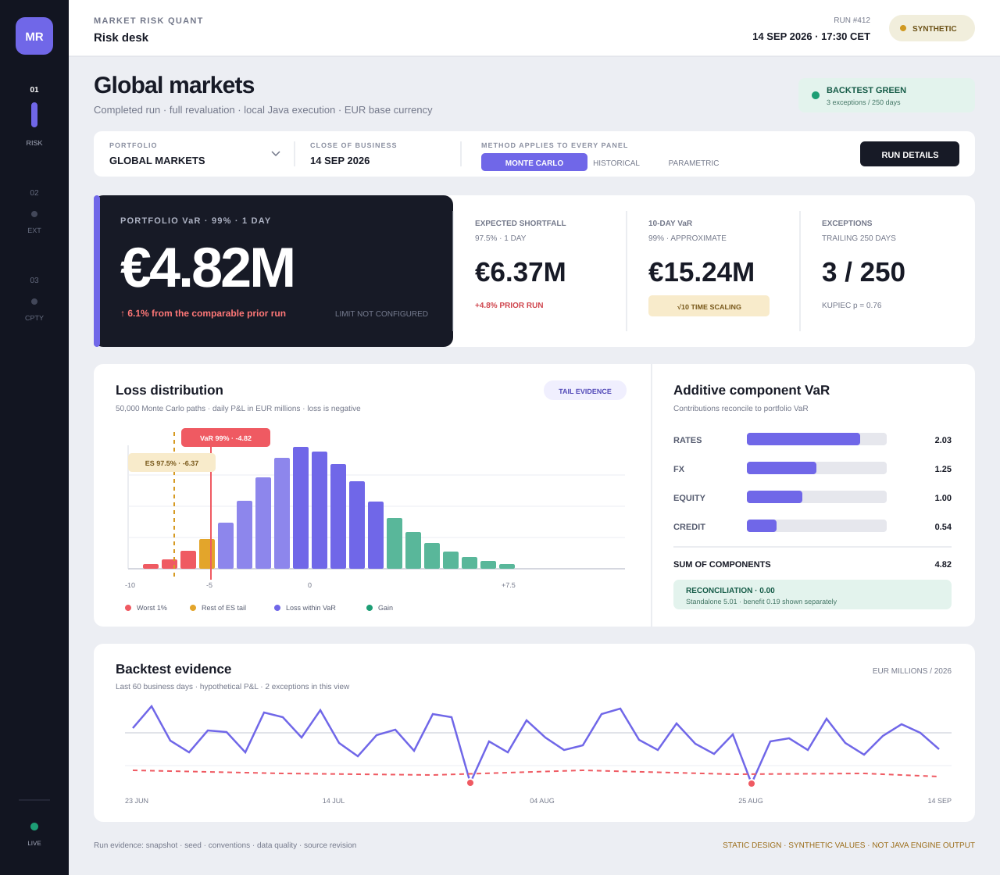

# Risk desk primary direction: Precision Ledger v2

## What changed

This revision preserves the first dashboard's calm analytical structure but removes the parts that
made it feel like a generic admin template.

| Before | Precision Ledger v2 |
|---|---|
| Four equal summary cards | One dominant VaR verdict plus a continuous supporting-measure ledger |
| Repeated rounded containers | Three structural stages: risk, evidence, backtest |
| Navigation spread across a conventional top bar | Compact dark rail gives the product a persistent identity |
| Histogram and attribution feel like separate widgets | One evidence field divided by a single structural rule |
| Reconciliation is a footer sentence | Reconciliation becomes a distinct, computed status inside attribution |
| Color is mostly decorative purple | Violet maps to the selected method and risk evidence; red, amber, and green retain semantic roles |

## Design direction

The visual world is a **precision instrument**, not a banking terminal and not a luxury dashboard.
Cool porcelain surfaces reduce glare; the obsidian rail anchors the screen; fine rules and compact
labels create discipline. Distinction comes from composition rather than effects: the asymmetric
metric ledger is the memorable element, and the evidence panels share one continuous surface.

The design remains operational:

- method selection applies to every panel;
- 10-day VaR is visibly approximate;
- component VaR sums to 4.82 with residual 0.00;
- standalone total 5.01 and diversification benefit 0.19 remain separate;
- the 60-day visible exception count is distinct from the 250-day diagnostic;
- missing limits are stated rather than rendered as zero utilisation.

## React implementation notes

Use CSS Grid for the asymmetric metric ledger and evidence stage. Avoid a generic `Card` wrapper:
the visual hierarchy depends on shared surfaces and structural dividers. Keep method, portfolio,
COB, and run identity at route level and fetch the screen as one compatible result. SVG charts may
use Visx or ECharts, but their annotations, threshold labels, and reconciliation state remain
first-class DOM/SVG content rather than tooltip-only details.

At narrow widths, collapse the rail to a bottom or compact top navigation, place the dominant VaR
block first, then stack supporting measures, distribution, attribution, and backtest. Do not shrink
the desktop composition into an unreadable miniature.
