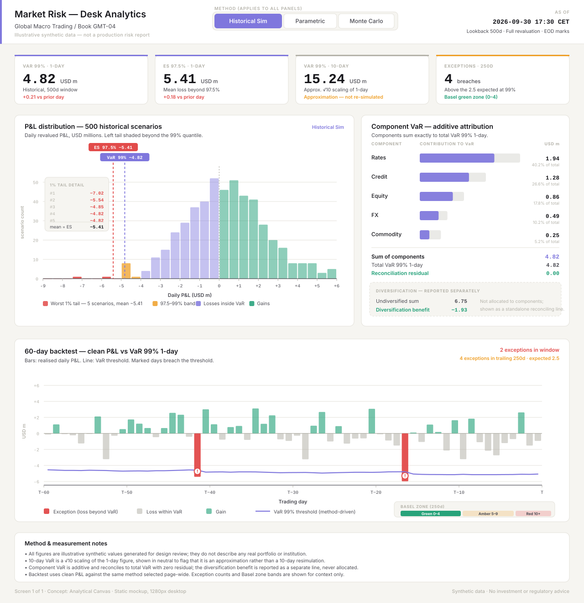

# Screen 1 variant — Analytical Canvas



> All figures in this mockup are **illustrative synthetic values** generated for design review. They do not describe any real portfolio, institution, or market state, and nothing here constitutes investment or regulatory advice.

## Concept

**Analytical Canvas** treats Screen 1 as a reviewer's workbench rather than an executive summary. The premise is that a quant reviewing the desk at end of day does not need decoration — they need to see the *shape* of the loss distribution, confirm that attribution *reconciles*, and check whether the model is *behaving* in backtest. Headline numbers are present and precise, but they are deliberately compact so that roughly two-thirds of the vertical space belongs to charts and comparison evidence.

The design makes three commitments:

1. **Method is a page-wide fact, not a per-panel toggle.** The Historical Simulation / Parametric / Monte Carlo selector sits in the header, visually attached to the page title. Every number and every chart below it is a consequence of that one choice. The distribution panel repeats the active method as a quiet purple tag so a screenshot of one panel is never ambiguous.
2. **Additivity is shown, not asserted.** Component VaR is displayed as a table of bars that ends in an explicit `Sum of components` / `Total VaR` / `Reconciliation residual = 0.00` block. A reviewer can verify the identity without leaving the panel.
3. **Diversification is never allocated.** The diversification benefit sits in its own dashed container, outside the additive table, labelled "reported separately". This prevents the common misreading where a benefit is silently spread across risk factors and the component figures stop being interpretable.

## Visual hierarchy

| Tier | Element | Rationale |
| --- | --- | --- |
| 0 | Page title + method selector | The method governs everything; it is read before any figure. |
| 1 | Four metric cards (VaR 99% 1d, ES 97.5% 1d, VaR 99% 10d approx., exceptions 250d) | Fixed-height, monospace numerals, 3px accent rule on top. Compact by design — they orient, they do not dominate. |
| 2 | P&L distribution (left, ~58% width) and Component VaR (right) | The two panels a reviewer compares against each other: what the tail looks like, and where it comes from. |
| 3 | 60-day backtest, full width | Diagnostics read left-to-right across the whole canvas, because time series compress badly in a narrow column. |
| 4 | Method & measurement notes | Caveats live at the bottom, always visible, never a tooltip. |

### Colour discipline

| Token | Hex | Meaning |
| --- | --- | --- |
| Purple | `#7F77DD` | The risk measure itself — VaR markers, component bars, the backtest threshold line, the active method chip. |
| Red | `#E24B4A` | Realised breach or tail region. Used only where a loss actually exceeded a threshold. |
| Amber | `#EF9F27` | Caution and approximation — the 97.5–99% band and the "not re-simulated" flag. |
| Green | `#1D9E75` | Gains, and reconciliation that checks out (`residual 0.00`, diversification benefit, Basel green zone). |
| Neutral | `#B4B2A9` | Scaffolding: axes, grids, standalone "ghost" bars, and — deliberately — the 10-day VaR accent. |

The 10-day card is the one intentional demotion. Its value is a √10 scaling of the 1-day figure, not an independent 10-day simulation, so it carries a neutral accent and an amber caveat line rather than the purple treatment given to directly measured quantities. A reviewer should not be able to mistake it for a re-simulated result.

## Panel notes

**P&L distribution.** 500 historical scenarios binned at 0.5m. Bars are coloured by where they fall relative to the quantiles: red beyond VaR 99%, amber across the rest of the 97.5–99% band, purple for losses inside VaR, green for gains. Dashed markers with monospace labels pin the VaR and ES quantiles. The empty far-left region — dead space in most histograms — carries a **2.5% tail detail** card that shows the arithmetic behind ES: the five worst scenarios individually, the mean of observations #6–#12, and the 13th at half weight, totalling the 12.5 observations that constitute the worst 2.5% of a 500-scenario set. The card ends on `2.5% tail mean = ES −5.14`, which is exactly the figure on the metric card.

The histogram is generated so that the empirical 1% quantile equals −4.82 (the 5th worst of 500) and the weighted mean of the worst 2.5% equals −5.14. The two headline risk numbers are therefore derived from the same synthetic scenario set that the chart draws, not authored independently. Bin colour is assigned by bin edge, so a 0.5m bin straddling a quantile takes the colour of the side it closes on; the dashed markers, not the bar colours, are the precise locators.

**Component VaR.** Each row shows a purple contribution bar against a neutral ghost bar for the standalone figure, so the compression from diversification is legible per factor without a second chart. Rates 1.94 + Credit 1.28 + Equity 0.86 + FX 0.49 + Commodity 0.25 = 4.82, matching the headline VaR. Undiversified sum 6.75 and benefit −1.93 are quarantined in the dashed block below.

**60-day backtest.** Realised daily P&L as bars against the VaR threshold as a purple line, with the threshold drawn as a *line* rather than a constant because it moves with the window. Two days breach in the visible window and are marked; the trailing 250-day count of 4 against 2.5 expected is stated in the header, and a compact Basel zone strip shows which band that count falls in. The header count and the zone strip agree — 4 exceptions is green zone, and the card says so.

## Interaction notes (for the live build)

These are static-mockup intentions, not implemented behaviour:

- **Method selector** re-fetches the whole screen. Panels should show a skeleton state rather than stale numbers, because a half-updated page mixing Historical bars with a Parametric VaR line is actively misleading.
- **Histogram bars** reveal a bin tooltip (range, scenario count, contribution to the tail). The 2.5% tail card rows link to the underlying scenario dates, and the `#6–#12` row expands to the individual observations.
- **Component rows** expand to sub-factor breakdown (e.g. Rates → curve / basis / vol). The reconciliation block recomputes at every level, so additivity is verifiable at any depth.
- **Diversification block** is never clickable into an allocation view. There is no drill-down, because allocating it is the thing the design is refusing to do.
- **Backtest bars** reveal date, clean P&L, threshold, and breach magnitude. Exception markers link to the incident record. The window is selectable (60d / 125d / 250d) without changing the 250d regulatory count.
- **Keyboard**: the method selector is a radiogroup with arrow-key traversal; each panel is a landmark region with a heading, so a screen-reader user can skip between distribution, attribution, and backtest.

## Strengths

- A reviewer can answer "is the tail fat, does attribution reconcile, is the model breaching?" without scrolling past the fold on a 1280×1344 canvas.
- Reconciliation is *visible arithmetic*, and it is applied to ES as well as to attribution: the tail card shows which observations enter ES 97.5% and at what weight, so the measure is auditable rather than asserted.
- Reconciliation is *visible arithmetic*. The residual line makes a broken attribution pipeline obvious at a glance instead of silently plausible.
- Method provenance is unambiguous everywhere, which matters most in screenshots pasted into email and tickets.
- Approximation is colour-coded, so the weakest number on the page is also the most visibly hedged.
- Colour carries one meaning each; nothing is coloured for emphasis alone.

## Tradeoffs

- **Density is high.** This screen assumes a trained reader. A CRO or a non-specialist stakeholder would likely prefer a headline-first variant; this one gives them four small cards and three charts.
- **Desktop-bound.** The two-column panel row and the 60-column backtest do not survive a narrow viewport without a genuine redesign, not just reflow.
- **Single portfolio, single day.** There is no book selector or trend-over-time view; comparison here means within-day reconciliation, not day-over-day drift.
- **The tail detail card is opinionated.** Listing five individual scenarios encourages anchoring on specific historical days, which can be a feature (incident recall) or a bias (over-fitting to one crisis). Collapsing observations #6–#12 into a mean keeps the card compact but hides seven scenarios behind one number.
- **Fractional tail observations need explanation.** 2.5% of 500 is 12.5 scenarios, so the half-weighted 13th observation is exposed in the card and the footnote. It is correct, but it is a detail a casual reader will skip.
- **No confidence framing on the exception count.** 4 versus 2.5 expected is shown as a count and a zone, not as a Kupiec-style test result; a stricter reviewer would want the p-value.

## React + TypeScript + Vite implications

**Component decomposition.** The screen maps to one `RiskScreen` route holding a single `method` state, with four leaf areas: `MetricCardRow`, `PnlDistributionPanel`, `ComponentVarPanel`, `BacktestPanel`. Method lives at the route, not in a panel — prop-drilling it one level is preferable to a context here, because the number of consumers is small and explicit dependency is the point.

```ts
type RiskMethod = 'historical' | 'parametric' | 'monte-carlo';

interface RiskScreenData {
  asOf: string;                 // ISO instant
  method: RiskMethod;
  metrics: {
    var99_1d: Money;
    es975_1d: Money;
    var99_10d: Money & { approximation: 'sqrt-time' };
    exceptions250d: { observed: number; expected: number; baselZone: 'green' | 'amber' | 'red' };
  };
  distribution: { binWidth: number; bins: Array<{ from: number; to: number; count: number }>;
                  quantiles: { q99: number; q975: number; es975: number };
                  /** The observations entering ES 97.5%, with the fractional last one weighted. */
                  esTail: { alpha: 0.025; scenarioCount: number; effectiveObservations: number;
                            observations: Array<{ scenario: Scenario; weight: number }> } };
  attribution: { components: Array<{ id: string; label: string; componentVar: number; standaloneVar: number }>;
                 totalVar: number; undiversifiedSum: number; diversificationBenefit: number };
  backtest: { days: Array<{ date: string; cleanPnl: number; varThreshold: number }> };
}
```

The `approximation: 'sqrt-time'` discriminant is worth encoding in the type rather than the copy — it makes the neutral/amber treatment a rendering consequence of the data contract instead of a hard-coded string a future edit can silently drop.

**Reconciliation as an invariant.** `sum(components) === totalVar` should be asserted in a dev-mode guard and surfaced as an error state in the panel, not assumed. The same applies to the tail: `sum(esTail.observations.map(o => o.pnl * o.weight)) / esTail.effectiveObservations === quantiles.es975`, with `effectiveObservations === alpha * scenarioCount`. Encoding the weights rather than a plain `worstScenarios: Scenario[]` is what prevents the classic defect of averaging a convenient handful of scenarios and labelling the result ES. The residual line renders the actual computed difference; if the backend drifts, the UI shows a non-zero residual in red rather than a confidently wrong chart. The diversification benefit is a separate field and is never summed into the component array — enforcing that in the type (`components` has no `diversification` member) is cheaper than enforcing it in review.

**Charts.** All three visualisations are rectangles, lines, and text on a linear scale. Rendering them as hand-built SVG with `d3-scale` for the axes avoids pulling a charting library for layouts that a library would fight. The static SVG in this repo is effectively the render target: same geometry, same tokens. If a library is preferred, Visx is the closer fit than Recharts, because the quantile markers, the tail card, and the Basel strip are all custom annotations.

**Performance.** 500 histogram bars would be wasteful; binning happens server-side and the client draws 30 rects. The backtest is 60 bars plus one polyline. Nothing here needs virtualisation or memo-heavy optimisation; the real cost is the method refetch, which should use a suspense boundary per panel with a skeleton, plus `keepPreviousData: false` so stale figures never paint under a new method label.

**Styling.** The five colours and the neutral scale belong in CSS custom properties consumed by both the DOM and the SVG (`fill="var(--risk-purple)"`), so a theme change does not require touching chart code. Numeric cells use `font-variant-numeric: tabular-nums` with a monospace stack — column alignment in the attribution table is functional, not cosmetic.

**Accessibility.** Each chart gets `role="img"` with an `aria-labelledby` pair, mirroring the pattern used in the static asset, plus a visually-hidden `<table>` equivalent for the distribution bins and backtest days so the data is reachable without reading pixel positions. The method selector is a `radiogroup`. Colour is never the sole signal: breaches carry a marker glyph, the residual carries an explicit `0.00`, and the approximation carries text.

**Vite specifics.** The mockup imports cleanly as a static asset (`import mockup from './risk-desk-variant-analytical-canvas.svg'`) for design-review routes, and the file uses no external fonts, no embedded rasters, and no CSS-only features, so it also renders correctly when inlined via `?raw` or committed into a docs site.
