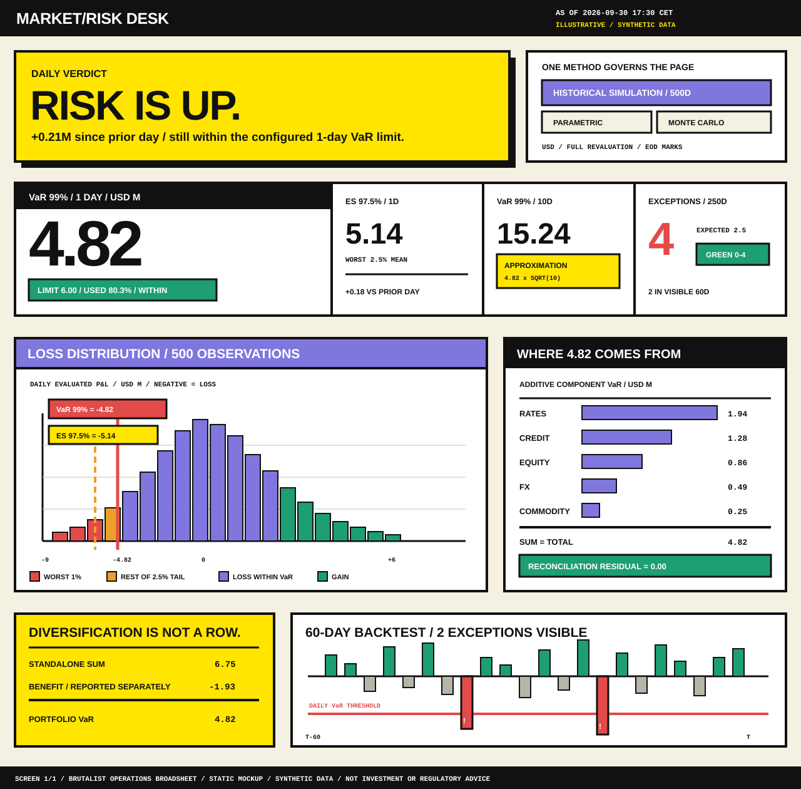

# Risk desk variant: Brutalist Operations Broadsheet

> All values are illustrative and synthetic. The mockup is a design exploration, not a live
> calculation, regulatory report, or statement about a real portfolio.

## Concept

This variant treats the risk desk as a printed operating sheet pinned to a control-room wall.
It rejects rounded cards, decorative gradients, and ambient depth. Structure is exposed through
heavy rules; the hierarchy comes from scale, contrast, and position. The result is deliberately
confrontational, but not careless: every signal colour has one meaning and every headline is tied
to arithmetic on the same page.

The brutalism is visual, not informational. The screen keeps the shared contract:

- VaR 99% 1-day is measured independently from ES 97.5% 1-day.
- ES 97.5% is the mean of the worst 2.5% of observations.
- VaR 99% 10-day is labelled as a square-root-of-time approximation.
- Component VaR is additive: 1.94 + 1.28 + 0.86 + 0.49 + 0.25 = 4.82.
- Diversification is reported separately: 6.75 - 1.93 = 4.82.
- Limit utilisation appears only because a matching 1-day VaR limit is explicitly configured.
- Four trailing-250-day exceptions and two visible 60-day exceptions are kept distinct.

## Visual system

| Element | Treatment | Purpose |
|---|---|---|
| Ground | Bone paper `#F4F0E2` | Reduces glare without suggesting a soft or premium surface |
| Structure | Near-black `#111111`, 3-4px rules | Makes grouping and reading order physical |
| Verdict | Signal yellow `#FFE500` | Reserves the loudest field for the daily conclusion and approximation |
| Risk measure | Purple `#7F77DD` | Connects method, distribution, and additive contribution |
| Breach | Red `#E24B4A` | Used only for realised exceptions and the 1% tail |
| Valid state | Green `#1D9E75` | Matching limit status, reconciliation, and gains |
| Numerals | Arial Black / tabular Courier | Large quantities are shouted; arithmetic remains aligned |
| Geometry | Square blocks and offset print shadow | Deliberately refuses the soft-card dashboard pattern |

## Hierarchy and interaction

1. **Verdict before inventory.** “RISK IS UP.” communicates direction before the reader parses
   four measures. The copy immediately qualifies that statement with the daily delta and limit state.
2. **Method is structural.** One method block governs the page; inactive methods remain visible as
   square controls.
3. **Evidence occupies the centre.** Distribution and additive attribution form one evidence row.
   Neither is visually demoted beneath a collection of metric cards.
4. **Diversification is a statement, not a bar.** Its yellow block explicitly says it is not an
   attribution row.
5. **Backtest closes the argument.** Breaches cross the red threshold and carry an exclamation mark,
   so colour is not the only signal.

In a live React implementation, the method selector is a page-level radiogroup. Histogram bins,
component rows, and backtest bars expose keyboard-focusable detail. The verdict must be derived from
typed status data rather than authored independently, and changing method must replace the full page
atomically so figures from different runs are never mixed.

## Strengths and tradeoffs

**Strengths:** unmistakable hierarchy; excellent distance readability; visible arithmetic; few
decorative elements; strong screenshot identity; square geometry maps cleanly to CSS Grid; status
does not depend on subtle colour differences.

**Tradeoffs:** the visual volume can fatigue users who keep the screen open all day; heavy rules
consume space; the oversized verdict is inappropriate for dense multi-portfolio comparison; the
style would need a calmer responsive interpretation rather than simple scaling on mobile; hard
print shadows and deliberately abrupt controls require careful focus-state design in the live UI.

## Frontend implications

The composition maps to a 12-column CSS Grid with no card abstraction. Use semantic regions for the
verdict, metric ledger, distribution, attribution, diversification, and backtest. A small token set
is enough: background, ink, four semantic colours, 3px/4px rules, and one offset-shadow primitive.
Charts can use SVG or Visx; their critical feature is not the library but keeping black outlines,
text labels, and non-colour breach markers intact. The wide desktop composition should switch at a
real breakpoint to a single-column reading sequence rather than squeezing the broadsheet.
