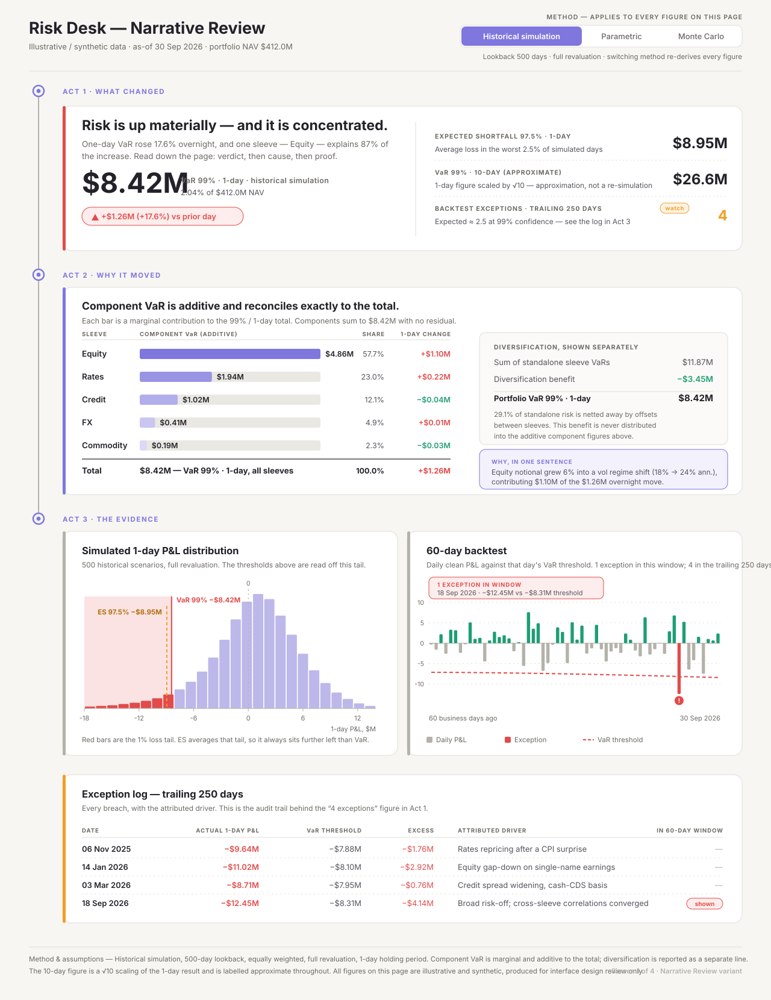

# Screen 1 variant — Narrative Review



**Asset:** `docs/assets/risk-desk-variant-narrative-review.svg` (1280 px desktop static mockup)

All figures in the mockup are **illustrative and synthetic**, produced for interface design review
only. Nothing on the screen is a regulatory, capital, or production risk report, and the copy in the
mockup says so on the page itself.

---

## 1. Concept and rationale

The conventional risk dashboard is a wall of cards. Every number has equal visual weight, so the
reviewer has to assemble the story themselves: scan, compare against memory, guess at causation, and
hunt for the supporting evidence. That works for someone who already knows the book. It fails for
the person actually doing a review — a supervisor, a new desk risk manager, a validator — who needs
to arrive at a defensible opinion quickly.

**Narrative Review** inverts that. The screen is a single argument, laid out in three acts along an
explicit vertical spine:

| Act | Question it answers | What it contains |
| --- | --- | --- |
| **Act 1 — What changed** | *Is anything wrong, and how badly?* | Verdict sentence, headline VaR 99% 1d, day-over-day delta, and the three supporting headline measures (ES 97.5% 1d, approximate VaR 99% 10d, exceptions over 250 days) |
| **Act 2 — Why it moved** | *What drove it?* | Additive component VaR reconciled to the total, per-sleeve 1-day change, and diversification reported as its own separate line |
| **Act 3 — The evidence** | *Do I believe it?* | P&L distribution with the thresholds marked in the tail, 60-day backtest, and the full exception log behind the 250-day count |

The left-hand rail with three nodes is the only ornament on the page, and it earns its place: it
tells the reviewer that the order is deliberate and that they have not finished until they reach the
bottom.

### Preserved quantitative truth

The variant changes presentation, not substance. Every quantity from the baseline screen is present
and internally consistent:

- **VaR 99% · 1-day — $8.42M** (2.04% of a $412.0M NAV), up **$1.26M / +17.6%** on the day.
- **ES 97.5% · 1-day — $8.95M**. Rendered to the left of the VaR line in the loss tail. The two
  measures use *different* thresholds: VaR 99% is the 99th-percentile loss, while ES 97.5% is the
  average of losses beyond the 97.5th percentile. In this synthetic distribution that average lands
  deeper in loss than VaR 99%; the mockup states the relationship as an observation, not a rule.
- **VaR 99% · 10-day — $26.6M, approximate.** Labelled as a √10 scaling of the 1-day figure in three
  places (the metric label, its note, and the footer). It is never presented as a re-simulation.
- **Exceptions · trailing 250 days — 4**, against an expected ≈ 2.5 at 99% confidence, flagged amber
  rather than red because it is a watch item, not a verdict.
- **Method selection is page-wide.** A single segmented control in the header, with explicit copy
  stating that switching method re-derives every figure below. There is no per-card method override.
- **P&L distribution** — 500 simulated 1-day scenarios; the worst 1% of scenarios (the tail VaR 99%
  cuts off) is coloured, the VaR line is solid, the ES 97.5% line is dashed.
- **Component VaR is additive and reconciles exactly**: 4.86 + 1.94 + 1.02 + 0.41 + 0.19 = **8.42**,
  with a 100.0% share column and no residual row.
- **Diversification is separate**: standalone sum 11.87 − benefit 3.45 = 8.42. It is shown in its own
  bordered panel with copy stating the benefit is never redistributed into the component figures.
- **60-day backtest** with the moving VaR threshold and a single exception in-window (18 Sep 2026),
  explicitly reconciled to the 4-in-250-days headline via the exception log in the same act.

### Palette

`#7F77DD` violet is the narrative/structural colour — act labels, the rail, component VaR bars (as a
five-step tint ramp), and the selected method segment. `#E24B4A` red is reserved for *risk increase
and loss*: the day-over-day delta, the distribution's loss tail, the VaR/ES threshold lines, the
breach bar, and the exception log. `#EF9F27` amber is the single "watch" state on the exception
count. `#1D9E75` green marks genuinely favourable quantities — the diversification benefit and
profitable backtest days. `#B4B2A9` is the neutral for grid, axes, bar tracks, and non-breach loss
days. Colour is never the sole carrier of meaning: every semantic state also has a label, a sign, or
a shape.

---

## 2. Visual hierarchy

1. **`$8.42M` at 46 px** is the single largest element on the page and the only one at that size.
2. **The verdict sentence at 23 px** sits above it. This is the deliberate inversion: the reviewer
   reads the *conclusion* before the number that supports it.
3. **Act labels at 11.5 px, letter-spaced violet** are small but high-contrast against the field of
   body copy, so the spine reads as structure rather than content.
4. **Supporting metrics in Act 1 are demoted** — 24 px values in a right-hand column behind a
   vertical divider, each with a one-line plain-language definition. They are context for the
   headline, not peers of it.
5. **Charts are third in weight.** They are large in area but low in contrast (tints, thin rules), so
   they read as evidence you *consult* rather than something shouting at you.
6. **The exception log is deliberately plain** — a monochrome table. Audit trails should look like
   audit trails.

Accent stripes on the left edge of each card encode act identity (red for the verdict, violet for
the explanation, stone/amber for evidence) so the structure survives when the page is scrolled and
the rail nodes are off-screen.

---

## 3. Interaction notes (for the live implementation)

The SVG is a static mockup; the behaviours it implies are:

- **Method selector** — a segmented radio group in the header. Changing it invalidates and refetches
  every figure on the page. During the refetch, all dependent numbers go to a skeleton state
  simultaneously, never partially, so the reviewer can never read a page that mixes two methods. The
  control is keyboard-operable with arrow keys and announces the recalculation via a polite live
  region.
- **The verdict sentence is generated, not authored** — it is templated from the same computed deltas
  shown in Act 2 (largest contributor, its share of the move, direction). It must never be able to
  disagree with the numbers beneath it, which means it is derived from them rather than stored.
- **Component rows are drill-down affordances.** Clicking a sleeve filters Acts 2 and 3 to that
  sleeve, and the act labels gain a breadcrumb ("Act 3 · The evidence — Equity only"). The total row
  and the diversification panel stay at portfolio level and are visibly dimmed, because a sleeve view
  has no meaningful diversification line of its own.
- **Distribution chart** — hovering a bin shows the scenario count and the P&L range; the VaR and ES
  markers have persistent labels rather than hover-only ones, since they are the point of the chart.
- **Backtest chart** — hovering a day shows date, clean P&L, and that day's threshold. Clicking the
  breach marker scrolls to and highlights the matching row in the exception log; clicking a log row
  does the reverse. This two-way link is what makes the "4 exceptions" headline auditable in two
  clicks.
- **Exception log** is sortable by date and by excess, and the "in 60-day window" column is the
  explicit bridge between the 250-day count and the 60-day chart.
- **Tooltips are never the only home for a definition.** Every metric carries its plain-language note
  inline, because a reviewer reading on a locked-down or touch device still needs it.

---

## 4. Strengths and tradeoffs

### Strengths

- **Shortest path to a defensible opinion.** The reviewer reaches a verdict in one fixation and can
  justify it in three scrolls. A card-grid layout cannot promise that.
- **Causation is designed in, not inferred.** The 1-day change column and the "why, in one sentence"
  panel force the answer to *why* to exist on the page, rather than living in a separate commentary
  document that drifts out of sync.
- **Reconciliation is visible, not claimed.** Additive components with a share column summing to
  100.0%, plus a separate standalone-minus-diversification panel, mean the reviewer can verify the
  arithmetic without leaving the screen.
- **Every headline has its evidence on the same page.** The 250-day exception count has a log; the
  VaR and ES numbers have the distribution they came from; the backtest and the log cross-reference
  each other.
- **Approximations are labelled at the point of use.** The 10-day figure is marked approximate in its
  label, its note, and the footer — three chances to not be misread.

### Tradeoffs

- **Opinionated ordering suits review, not monitoring.** A trader watching intraday wants a dense
  glanceable grid, not a three-act essay. This layout is for the review moment; it would be a poor
  default for a wall monitor.
- **Vertical length.** At 1280 px wide the page runs ~1660 px tall. Act 3 is below the fold on a
  laptop. That is an accepted cost — evidence *should* require deliberate effort to reach — but it
  means the Act 1 verdict has to be genuinely trustworthy on its own.
- **The generated verdict sentence is a liability if it is ever wrong.** It needs tight templating,
  explicit thresholds for words like "materially", and a fallback to a neutral phrasing when the
  drivers are diffuse rather than concentrated.
- **Only one dimension of "why".** The current design attributes the move to sleeves. It does not yet
  decompose into position change vs. market move vs. model/parameter change, which a rigorous
  reviewer will eventually ask for.
- **Less flexible than a grid.** Cards can be reordered, hidden, or made user-configurable. A
  narrative cannot — removing Act 2 breaks the argument. Personalisation has to be limited to
  within-act density.
- **Colour ramp on component bars encodes rank, not category.** A five-step violet ramp reads cleanly
  but makes cross-screen comparison harder if another screen gives each sleeve a fixed hue. Worth
  resolving as a system-level decision.

---

## 5. React + TypeScript + Vite implications

### Component decomposition

```
<RiskNarrativePage>
  <PageHeader>                       // title, as-of, synthetic-data notice
    <MethodSelector />               // page-wide radio group, single source of truth
  <NarrativeRail>                    // renders the spine; acts register with it
    <Act id="what-changed">
      <VerdictBanner />              // headline metric + generated verdict + delta chip
      <SupportingMetricList />       // ES 97.5% 1d, VaR 10d (approx.), exceptions 250d
    <Act id="why-it-moved">
      <ComponentVarTable />          // additive bars + share + 1-day change
      <DiversificationPanel />       // standalone sum, benefit, reconciled total
      <WhyCallout />                 // templated from the same deltas
    <Act id="the-evidence">
      <PnlDistributionChart />
      <BacktestChart />
      <ExceptionLog />
```

### State and data flow

- **One query key, one method.** The selected method belongs to a single page-level store (URL search
  param backed by `useSearchParams`, so a review is shareable and reproducible). Every data hook
  takes `method` as part of its query key. Making the method a URL param rather than local state is
  what makes "send me the screen you were looking at" work.
- **One payload, not seven.** Because every figure must agree, the page should fetch a single
  `RiskSnapshot` from one endpoint rather than composing seven independent requests that can resolve
  against different snapshots. Partial-consistency bugs on this screen are correctness bugs, not
  cosmetic ones.
- **Reconciliation invariants belong in the type layer.** Model the component breakdown so the total
  is derived, not transported:

  ```ts
  type Sleeve = 'equity' | 'rates' | 'credit' | 'fx' | 'commodity';

  interface ComponentVar {
    readonly sleeve: Sleeve;
    readonly contribution: number;   // additive, same units as total
    readonly standalone: number;
    readonly dayChange: number;
  }

  interface VarBreakdown {
    readonly components: readonly ComponentVar[];
    readonly total: number;          // must equal sum of contributions
    readonly diversificationBenefit: number; // standaloneSum - total, reported separately
  }
  ```

  Add a dev-only assertion that `|Σ contribution − total| < tolerance` and that
  `|Σ standalone − total − diversificationBenefit| < tolerance`. A silent reconciliation failure is
  the worst outcome this screen can produce, so it should fail loudly in development and render an
  explicit "reconciliation unavailable" state in production rather than a plausible wrong number.
- **Approximation is a property of the value, not of the label.** Carry it in the type
  (`{ value: number; basis: 'simulated' | 'sqrt-time-scaled' }`) so a metric can never be rendered
  without its qualifier. This is exactly the kind of thing that gets dropped when a component is
  reused on another screen.

### Rendering and charts

- **Charts should be SVG rendered by React, not canvas.** All three are small-N (26 bins, 60 days,
  5 bars), so there is no performance argument for canvas, and SVG gives DOM nodes that can carry
  `role`, `aria-label`, focus, and keyboard handlers for free.
- **Scales, not hand-tuned pixels.** Use `d3-scale` for the axes and keep the drawing in JSX. Avoid
  a full charting library here: the distribution's threshold markers, the backtest's moving
  threshold line, and the breach annotation are all bespoke, and fighting a chart library's
  abstraction costs more than writing ~120 lines of JSX per chart.
- **`viewBox` + `preserveAspectRatio`, no fixed pixel widths.** The mockup is 1280 px because it is a
  desktop spec, but the implementation should let each chart fill its container and reflow. Below
  ~1024 px the two Act 3 charts stack; below ~768 px the Act 1 supporting metrics move beneath the
  verdict and the rail collapses to act headers only.
- **Theme tokens, not literals.** The five palette values become CSS custom properties with semantic
  aliases (`--risk-increase`, `--risk-watch`, `--risk-benefit`, `--narrative-accent`,
  `--neutral-data`). The component ramp is generated from `--narrative-accent`.

### Vite specifics

- The mockup ships as a static `.svg` under `docs/assets/`. Vite can import it with `?url` for
  documentation pages, or `?raw` if it is ever inlined into a design-reference route. It is not part
  of the application bundle.
- Number formatting via a single shared `Intl.NumberFormat` instance module — creating formatters
  inside render is a real cost when the exception log and component table re-render together.
- Charts should be lazy-boundaried (`React.lazy` + `Suspense`) at the Act 3 level. Act 3 is below the
  fold by design, so deferring it improves time-to-verdict, which is the metric this whole layout
  exists to optimise.

### Accessibility

- The three acts are `<section>` elements with `aria-labelledby` pointing at their act headings, so
  screen-reader landmark navigation follows the same narrative order as the visual design.
- Each chart is `role="img"` with a `<title>`/`<desc>` pair summarising its finding in words — the
  same technique used in the mockup asset itself — with the underlying data also available as a
  visually hidden `<table>` for anyone who needs the values rather than the shape.
- The method selector announces recalculation through a polite live region; the verdict sentence is
  in an `aria-live="polite"` region so a method change re-announces the conclusion.
- Contrast: body copy and all metric values are checked against the warm off-white surface at AA or
  better. The amber "watch" chip uses a darkened text tone rather than `#EF9F27` on white, and the
  ES marker label uses a darkened amber for the same reason.
